# UAMIS

**Uncertainty-Aware Multimodal IHC–Sequence Modeling for Identifying Tumor-Associated Protein Subcellular Mislocalization**

UAMIS is a computational framework for prioritizing tumor-associated protein subcellular mislocalization from paired normal–tumor IHC–sequence data. The public workflow starts from stochastic localization predictions produced by a compatible pretrained multimodal localization model and implements the downstream analysis used by UAMIS: MC-Dropout summarization, protein-level profile aggregation, relative-distribution normalization, Jensen–Shannon divergence (JSD) screening, and interfaces for biological evidence analysis.


## Overview

```mermaid
flowchart LR
    A[Paired IHC image + protein sequence] --> B[Pretrained ProLoc-IHS]
    B --> C[MC-Dropout predictions\nR x N x 5]
    C --> D[Image-level MC mean\nand uncertainty summary]
    D --> E[Protein-level aggregation\nby tissue state]
    E --> F[Relative localization\ndistributions]
    F --> G[JSD normal vs tumor]
    G --> H[Candidate mislocalized proteins]
    H --> I[Literature / DAVID / TCGA\nbiological interpretation]
```



The five localization categories are ordered as:

1. Cytoplasm
2. Endoplasmic reticulum
3. Mitochondria
4. Nucleus
5. Plasma membrane

## What is included

```text
UAMIS/
├── README.md
├── prepare_paired_metadata.py          # optional metadata validation and tissue/state splitting
├── summarize_mc_predictions.py # MC-Dropout mean, SD and confidence-interval summaries
├── jsd_screening.py             # protein aggregation, normalization, JSD and candidate screening
├── biological_evidence.py     # literature/DAVID/TCGA evidence interfaces
├── run_pipeline.py              # main analysis entry point
├── configs/
│   └── pipeline.json
├── docs/
│   └── input_format.md
├── tests/
│   ├── test_pipeline.py
│   └── test_biological_evidence.py
└── requirements.txt
```

## Upstream localization predictions

For each paired IHC image and protein sequence, a pretrained ProLoc-IHS model is used to generate five independent Sigmoid localization probabilities. During inference, dropout is kept active and the same sample is evaluated repeatedly. In the study, the number of stochastic forward passes was:

```text
R = 30
```

UAMIS expects the resulting stochastic prediction tensor for each tissue state in the form:

```text
mc_predictions.npy     shape = [R, N, 5]
metadata.csv           N rows, in exactly the same sample order
```

`N` is the number of IHC images in the corresponding tissue/state subset. The five Sigmoid outputs are not required to sum to one.

The pretrained localization model, its weights, and feature-extraction implementation are intentionally kept outside this repository. A compatible upstream implementation only needs to provide prediction tensors and aligned metadata that satisfy the input contract described in [`docs/input_format.md`](docs/input_format.md).

## Installation

Python 3.10 or later is recommended.

```bash
python -m venv .venv
# Linux/macOS
source .venv/bin/activate
# Windows PowerShell
# .venv\Scripts\Activate.ps1

python -m pip install -r requirements.txt
```

## Input layout

A typical local layout is:

```text
inputs/
├── Breast/
│   ├── normal/
│   │   ├── metadata.csv
│   │   └── mc_predictions.npy
│   └── tumor/
│       ├── metadata.csv
│       └── mc_predictions.npy
├── Cervix/
│   └── ...
└── ...
```

Minimal `metadata.csv` columns:

```text
Protein Name,Protein Id
```

Additional non-identifying columns such as `Antibody Id` or `Sample Id` may be retained. Row `i` of `metadata.csv` must correspond to column/sample index `i` of `mc_predictions.npy`.

No study data are included in this repository.

## Quick start

Edit [`configs/pipeline.json`](configs/pipeline.json) if needed, then run:

```bash
python run_pipeline.py --config configs/pipeline.json
```

The pipeline performs the following steps for each selected tissue:

1. validates the normal and tumor MC prediction tensors;
2. computes image-level MC means, predictive SDs, and 95% CI widths;
3. averages image-level MC means for each protein and tissue state;
4. converts the five aggregated Sigmoid scores into a relative localization distribution;
5. computes normal–tumor JSD;
6. prioritizes candidates using the configured JSD cutoff;
7. reports dominant-localization changes and threshold-sensitivity summaries.

The relative distribution for protein `g`, state `s`, and category `j` is computed as

\[
q_{g,j}^{(s)} =
\frac{\bar p_{g,j}^{(s)} + \delta}
{\sum_{k=1}^{5}(\bar p_{g,k}^{(s)} + \delta)}.
\]

The default numerical-stability constant is `delta = 1e-12`, and the default candidate cutoff is `JSD >= 0.1`.

## Main outputs

```text
results/
├── image_level/
│   └── <Tissue>/<State>/image_level_summary.csv
└── screening/
    ├── protein_jsd.csv
    ├── candidates.csv
    ├── excluded_proteins.csv
    ├── summary_by_tissue.csv
    └── threshold_sensitivity.csv
```

`screening/protein_jsd.csv` contains the aggregated normal/tumor localization scores, normalized relative distributions, JSD values, dominant localization categories, and candidate status for each paired protein.

`screening/threshold_sensitivity.csv` reports candidate counts at JSD cutoffs 0.05, 0.10, 0.15, and 0.20, both overall and by tissue.

## Biological evidence interfaces

Candidate interpretation is intentionally separated from automated screening.

```bash
# Export candidate identifiers for downstream review
python biological_evidence.py export \
  --candidates results/screening/candidates.csv \
  --output results/biological_evidence_inputs

# Import a manually curated literature-evidence table
python biological_evidence.py literature \
  --candidates results/screening/candidates.csv \
  --evidence literature_review.csv \
  --output results/literature

# Import a DAVID Functional Annotation Chart export
python biological_evidence.py david \
  --input Breast_david.tsv \
  --tissue Breast \
  --output results/david_Breast

# Summarize externally obtained TCGA z-scores
python biological_evidence.py tcga \
  --candidates results/screening/candidates.csv \
  --input Breast_tcga_zscores.tsv \
  --tissue Breast \
  --output results/tcga_Breast
```

Literature review and DAVID enrichment are external biological-analysis steps. The code validates and summarizes supplied results; it does not automatically infer literature support or query DAVID on behalf of the user.

## Data flow and reproducibility boundary

Original data resources used in the study were obtained from public databases, including the Human Protein Atlas (HPA), UniProt, and TCGA. Users should obtain these resources directly from their official sources and comply with their respective terms of use.

## Tests

The tests use small synthetic arrays data.

```bash
python -m unittest discover -s tests -v
```

## Citation

Citation information will be added upon publication.
